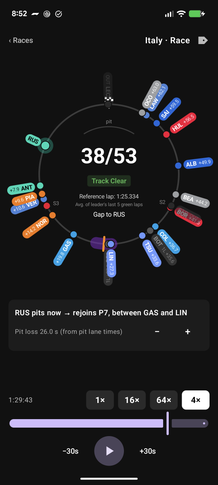
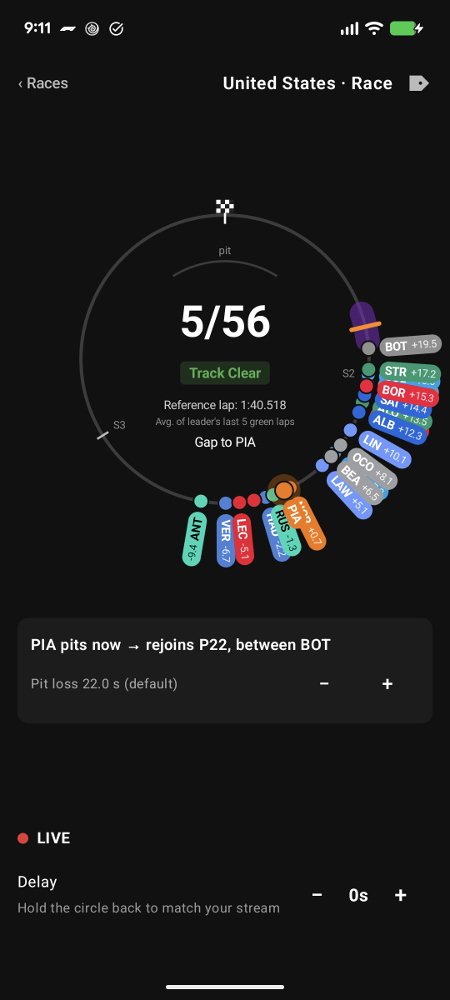
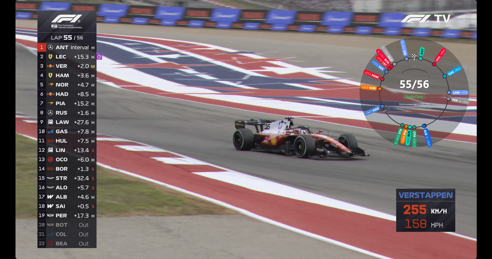

# F1 Circle

The F1 "circle of doom" for Android and Windows: every car drawn on a single circle that
represents one lap, placed by **time** rather than distance, so the spacing between dots is the gap
between cars. Select a driver to see where they would come back out if they pitted right now.

The Android app works live during a session and as a replay of past races. The Windows version
floats the live circle over your stream as an overlay.

<p>
  
  
</p>

## Features

- **Live mode** follows whatever session is running, straight from F1's live timing feed. No login
  needed. Pause, step back a second at a time to line the circle up with your stream, or jump back
  to live.
- **Replay** any race from 2023 on, with a timeline, ±30 s skips and 1×–64× speed.
- **Pit window**: select a driver to see the band where they would rejoin, the position they would
  drop to, and the cars either side. Pit loss is measured from the race's own clean stops (or the
  typical pit-lane time until there are enough), reduced under a safety car or VSC, and can be
  nudged by hand (Android).
- **Gaps** on every label, relative to the leader or to the selected driver. Cars a lap or more
  away from the selected driver turn grey.
- Track status (green, SC, VSC, red flag, chequered), lap counter, a reference lap time, and the
  sector lines learned from the session itself.
- Labels can be hidden per driver; the choice is remembered across races (Android).

## Windows overlay

The `desktop` module is a frameless, transparent, always-on-top window showing the live circle, to
sit over F1 TV or any other player (windowed, or browser/borderless fullscreen; not exclusive
fullscreen).



- **Unlocked** (the default at start), the window has a frame and controls: drag the top-left
  handle to move it, the bottom-right corner to resize, and click drivers to select them.
- **Locked**, only the circle shows and clicks pass straight through to the video underneath.
- **Delay**: the timing feed usually runs ahead of the broadcast. Step the circle back in 1 s or
  0.1 s steps until it matches the video; the delay is saved and reused next time. Pause works
  like pausing the stream.
- The backdrop behind the circle can be switched between 0, 30, 55 and 80% so it reads over
  bright footage. Window position, size, backdrop and delay are saved between runs.

Hotkeys work anywhere, including while the overlay is locked:

| Keys | Action |
| --- | --- |
| Ctrl+Alt+L | Lock (click-through) / unlock |
| Ctrl+Alt+H | Hide / show |
| Ctrl+Alt+P | Pause / resume |
| Ctrl+Alt+, / Ctrl+Alt+. | 1 s further behind / closer to live |
| Ctrl+Alt+Shift+, / Ctrl+Alt+Shift+. | Same in 0.1 s steps |
| Ctrl+Alt+[ / Ctrl+Alt+] | Select the driver ahead / behind |
| Ctrl+Alt+\ | Clear the selection |

If another app already holds one of these, the overlay's **?** panel marks it in red.

The overlay is live-only for now: replay, hiding labels and nudging the pit loss are only in the
Android app.

## How it works

The circle is a lap measured in time: an angle is a share of the reference lap (the average of the
leader's last five green-flag laps). That keeps one second the same size everywhere on the circle,
so gaps and the pit-loss band read correctly whatever part of the track a car is on.

Cars are positioned from timing data, not GPS:

1. Every sector-line crossing is an exact anchor for that car. Between anchors it moves at its
   recent pace and never passes a timing line it hasn't been seen crossing.
2. A car's gap to the leader means it is where the leader was that many seconds ago, so everyone
   else is placed along the leader's interpolated path. This is far more precise than
   extrapolating each car on its own.

Checked against real sector crossings (where the model had each car just before the crossing came
in, versus where it actually was):

| Data | Median error | 90% within |
| --- | --- | --- |
| 2026 Italian GP replay (SC, red flag, VSC) | 0.06 s | 0.17 s |
| 2026 US GP live feed | 0.05 s | 0.14 s |

Using each car's own sector times alone gives a 0.17 s median and 0.50 s at the 90th percentile.

## Data sources

| Mode | Source | Notes |
| --- | --- | --- |
| Live | `livetiming.formula1.com/signalrcore` (SignalR Core) | Anonymous access covers everything the app uses. An F1 TV login would only add car GPS positions, which aren't needed. |
| Replay | [OpenF1](https://openf1.org) historical API | Free, 2023 onwards. OpenF1 blocks all free requests while a live session is running, so race lists and opened races are cached on the device. |

F1's own archive of past sessions (`livetiming.formula1.com/static`) now requires authentication,
so it isn't used.

## Building

Requirements: JDK 17+ and the Android SDK with platform 37. The Android app runs on Android 8.0+;
the overlay runs on Windows.

```bash
./gradlew installDebug        # build and install on a connected device
./gradlew :core:test          # model, parser and live-feed tests
```

The model tests run against the 2026 Italian GP data in `core/src/test/resources`. The live-feed
accuracy test needs a recorded feed (one SignalR message per line, prefixed with the receive time in
ms) and is skipped without one:

```bash
F1_LIVE_RECORDING=/path/to/recording.jsonl ./gradlew :core:test
```

The Windows overlay:

```bash
./gradlew :desktop:run                   # run it from the build
./gradlew :desktop:createDistributable   # standalone folder with its own Java runtime
./gradlew :desktop:packageMsi            # installer (fetches the WiX toolset on first use)
```

Outputs land in `desktop/build/compose/binaries/main/`.

Release builds are signed from a `keystore.properties` file at the repo root (gitignored):

```properties
storeFile=/path/to/f1-circle-release.jks
storePassword=...
keyAlias=f1-circle
keyPassword=...
```

```bash
./gradlew assembleRelease     # signed APK in app/build/outputs/apk/release/
```

Without that file, `assembleRelease` produces an unsigned APK.

## Project layout

```
core/src/main/kotlin/com/f1circle/app/     plain Kotlin, shared by both apps
  data/
    LiveTimingClient.kt     SignalR connection to F1 live timing, with reconnects
    LiveSessionBuilder.kt   folds the live feed into SessionData
    OpenF1Client.kt         downloads and caches historical sessions
    OpenF1Parser.kt         OpenF1 JSON → SessionData
    Models.kt               shared data types
  model/
    CircleModel.kt          places cars, reference lap, sector lines, pit loss and rejoin window
    Smoothing.kt            eases dots towards new positions between updates
ui-shared/src/com/f1circle/app/ui/
  CircleCanvas.kt           draws the circle, cars and labels; tap handling
app/src/main/java/com/f1circle/app/ui/     Android
  LiveScreen.kt             live view with pause and delay
  ReplayScreen.kt           replay view, pit panel, label menu
  SessionPicker.kt          race list and live entry point
desktop/src/main/kotlin/com/f1circle/desktop/   Windows overlay
  Main.kt                   overlay window and hotkey actions
  Overlay.kt                circle, edit controls, resize grip, hotkey help
  LiveCircle.kt             live feed → frames, held behind live by the stream delay
  Windows.kt                click-through and global hotkeys (Win32 via JNA)
  Settings.kt               saved delay, backdrop and window bounds
```

`CircleCanvas.kt` is compiled into both apps from `ui-shared/` rather than being a module: Jetpack
Compose (Android) and Compose Multiplatform (desktop) have the same APIs but separate artifacts, so
a single library can't serve both without converting the project to Kotlin Multiplatform.

## Disclaimer

Unofficial and not associated with Formula 1 or OpenF1. F1, FORMULA 1 and related marks are
trademarks of Formula One Licensing B.V. Timing data belongs to its respective owners.
